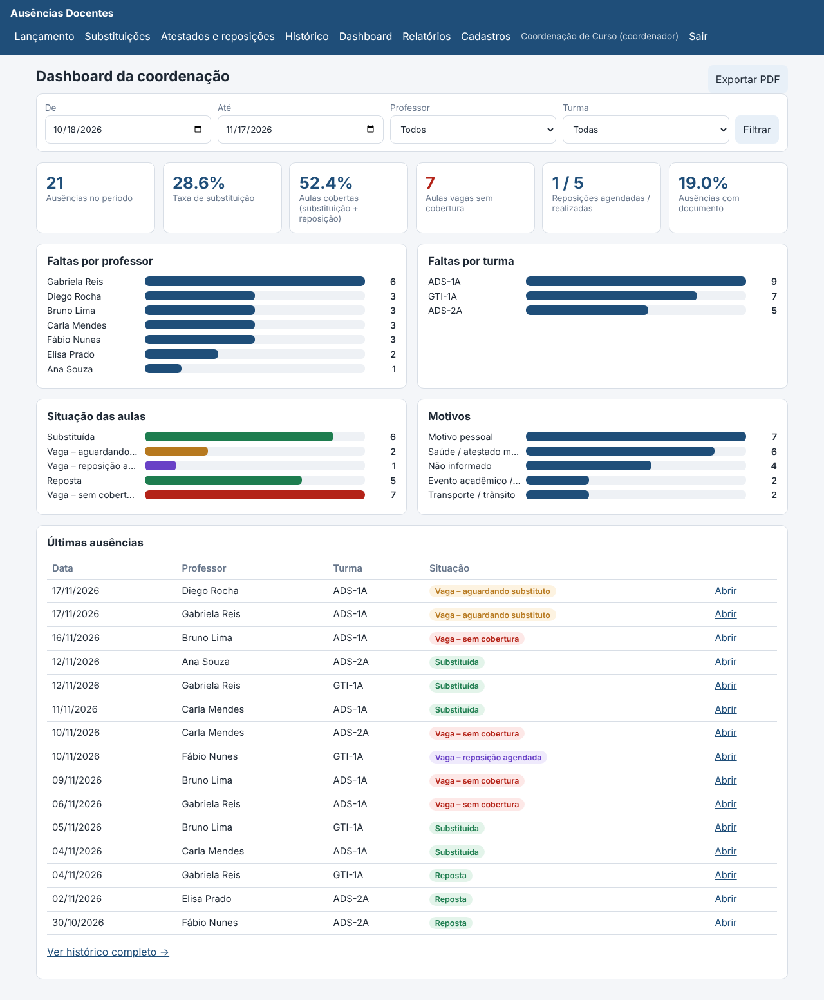

# Gestão de Ausências Docentes e Substituições

Projeto de extensão desenvolvido em parceria com a **Faculdade Impacta**, com acompanhamento de orientador.

Módulo para a secretaria de coordenação registrar ausências docentes, alocar substitutos no mesmo dia, controlar atestados e reposições e oferecer à coordenação um dashboard com indicadores e relatórios em PDF.



## Tema

Desenvolvimento de um módulo de gestão de ausências docentes e substituições para a secretaria de coordenação, com foco em automação, rastreabilidade e geração de relatórios gerenciais.

## Objetivo geral

Automatizar o registro diário de ausências docentes, a alocação de substitutos, o controle de atestados e reposições e a geração de relatórios e dashboards para a coordenação. A secretaria registra faltas, classifica aulas vagas, acompanha reposições e guarda evidências; o coordenador tem um painel com indicadores e exportação em PDF para reuniões com professores.

**Público-alvo:** secretaria de coordenação, coordenadores acadêmicos, professores e, indiretamente, os alunos afetados por ausências.

## Escopo e situação das funcionalidades

| Funcionalidade | Situação | Onde está |
|---|---|---|
| Lançamento diário de ausências (professor, disciplina, horário, turma), manual ou pela grade do dia | ✅ MVP | `app/routes/ausencias.py` |
| Gestão de substituições no mesmo dia, com sugestão de professores disponíveis | ✅ MVP | `app/routes/substituicoes.py`, `app/services.py` |
| Classificação automática das aulas vagas | ✅ MVP | `services.classificar()` |
| Atestados e comprovações (upload PDF/JPG/PNG) com aprovação | ✅ MVP | `app/routes/documentos.py` |
| Agendamento de reposições e comprovação pelo professor | ✅ MVP | `app/routes/documentos.py` |
| Dashboard do coordenador com filtros (período, professor, turma) e indicadores | ✅ MVP | `app/routes/dashboard.py` |
| Relatório em PDF (histórico de ausências e reposições) | ✅ MVP | `app/reports.py` |
| Interface responsiva (celular) | ✅ MVP | `app/static/style.css` |
| Rastreabilidade (histórico de ações por ausência) | ✅ MVP | modelo `Historico` |
| Integração com o sistema da instituição (importação CSV da grade + API JSON) | ✅ MVP | `app/importacao.py`, `app/routes/api.py` |

### Classificação automática das aulas

| Situação | Regra |
|---|---|
| **Substituída** | há substituto atribuído |
| **Reposta** | alguma reposição foi realizada/comprovada |
| **Vaga – reposição agendada** | sem substituto, com reposição agendada |
| **Vaga – aguardando substituto** | sem cobertura, mas a aula ainda não terminou |
| **Vaga – sem cobertura** | a aula terminou sem substituto nem reposição |

## Stack escolhida (e por quê)

| Camada | Tecnologia | Motivo |
|---|---|---|
| Linguagem | Python 3.11+ | Conhecida pela equipe, legível para quem vai manter |
| Web | Flask 3 + Jinja2 | Micro-framework simples, poucas camadas, ideal para trabalho acadêmico |
| Banco | SQLite via SQLAlchemy | Zero configuração; trocar para PostgreSQL/MySQL é só mudar `DATABASE_URL` |
| PDF | ReportLab | Gera PDF em Python puro, sem dependências do sistema operacional |
| Interface | HTML + CSS próprio (mobile first) | Sem build de front-end e sem depender de CDN |
| Testes | pytest + GitHub Actions | Testes unitários e de integração rodando a cada push |

## Como rodar

```bash
python -m venv .venv
source .venv/bin/activate          # Windows: .venv\Scripts\activate
pip install -r requirements.txt
flask --app run seed               # cria o banco com dados de demonstração
flask --app run run                # abre em http://127.0.0.1:5000
```

Usuários de demonstração (senha `demo123`):

| Perfil | E-mail |
|---|---|
| Secretaria | `secretaria@demo.edu.br` |
| Coordenador | `coordenador@demo.edu.br` |
| Professor | `professor@demo.edu.br` |

Outros comandos:

```bash
flask --app run criar-usuario                        # cria um usuário real
flask --app run importar-grade docs/exemplos/grade.csv  # importa a grade horária
pytest -v                                            # roda os testes
```

## Estrutura do repositório

```
app/
  __init__.py        fábrica da aplicação
  models.py          entidades (professor, disciplina, turma, aula, ausência, substituição, reposição, anexo, histórico)
  services.py        regras de negócio (classificação, sugestão de substitutos, indicadores)
  reports.py         geração do PDF
  importacao.py      importação da grade horária (CSV)
  routes/            um blueprint por área funcional
  templates/         telas (Jinja2)
  static/style.css   estilos responsivos
tests/               testes unitários e de integração
docs/                documentação das 6 fases do projeto
```

## Documentação por fase

| Fase | Documento |
|---|---|
| 1. Levantamento e requisitos | [docs/01-requisitos.md](docs/01-requisitos.md) |
| 2. Modelagem e prototipação | [docs/02-modelagem.md](docs/02-modelagem.md) |
| 3. Desenvolvimento do módulo | [docs/03-desenvolvimento.md](docs/03-desenvolvimento.md) |
| 4. Testes e validação | [docs/04-testes.md](docs/04-testes.md) |
| 5. Implantação e treinamento | [docs/05-implantacao-e-treinamento.md](docs/05-implantacao-e-treinamento.md) e [manual do usuário](docs/manual-do-usuario.md) |
| 6. Avaliação e relatório final | [docs/06-avaliacao.md](docs/06-avaliacao.md) |

Como a equipe trabalha no repositório: [CONTRIBUTING.md](CONTRIBUTING.md).

## Resultados esperados

- Redução de pelo menos 50% no tempo de registro e gestão de ausências.
- Aumento de 30% na taxa de substituição imediata de aulas.
- 100% dos atestados e comprovações armazenados digitalmente e acessíveis.
- Relatórios e dashboards gerados automaticamente.
- Satisfação dos usuários (secretaria, coordenadores e professores).

## Equipe

Projeto desenvolvido por estudantes da Faculdade Impacta: Kauã ([@Kerchak26](https://github.com/Kerchak26)), [@DevPlapes](https://github.com/DevPlapes), [@Toxiros0804](https://github.com/Toxiros0804), [@meirellx-dev](https://github.com/meirellx-dev) e [@FelipedeOliveira16](https://github.com/FelipedeOliveira16).

Acompanhamento: Osvaldo Takai e Renato Santos (Faculdade Impacta).
