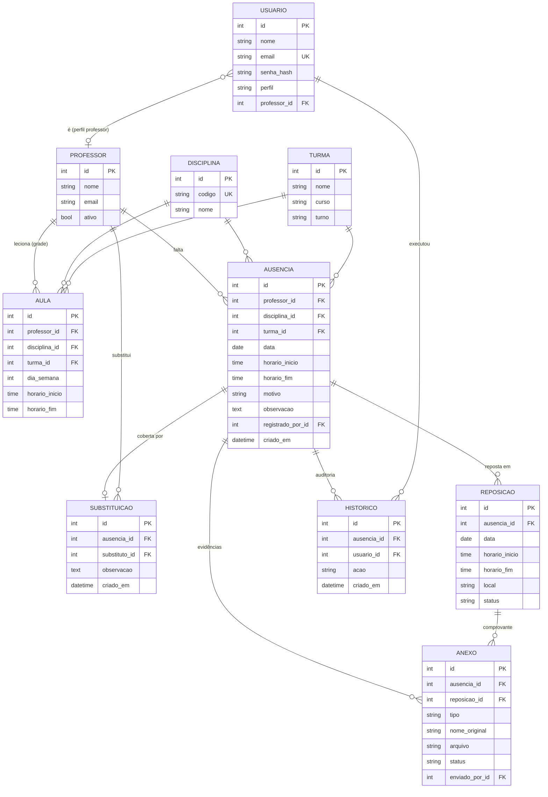
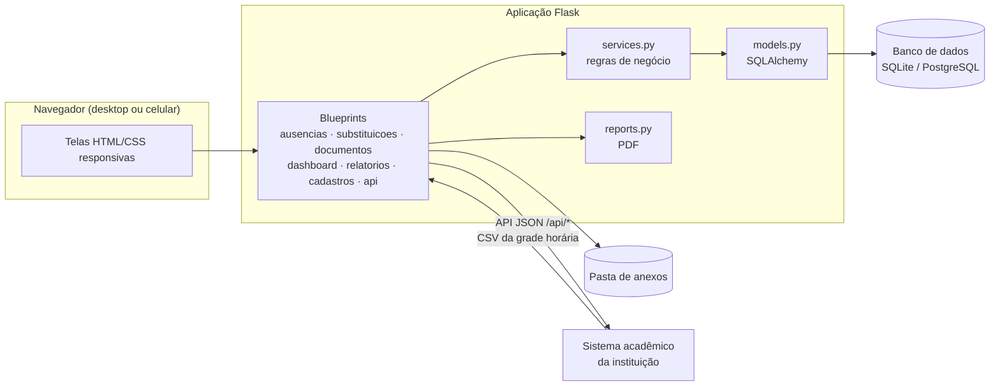

# Fase 2 — Modelagem e prototipação

## 1. Modelo de dados

### Decisões de modelagem

- **Ausência guarda professor, disciplina, turma e horário** (e não só a aula da grade): permite registrar faltas em aulas extras ou fora da grade e preserva o histórico mesmo se a grade mudar no semestre seguinte.
- **A classificação da aula não é gravada**: é calculada a partir da substituição, das reposições e do horário (`services.classificar`). Assim nunca fica desatualizada.
- **Substituição é 1:1 com ausência** (restrição `unique`). Trocar o substituto substitui o registro e gera histórico.
- **Anexo único para atestados, declarações e comprovantes**, diferenciados por `tipo`, com fluxo de aprovação (`pendente → aprovado/recusado`).
- **Histórico** registra tudo o que acontece com cada ausência (rastreabilidade exigida pelo tema).

### Domínios

| Campo | Valores |
|---|---|
| `Usuario.perfil` | `secretaria`, `coordenador`, `professor` |
| `Ausencia.motivo` | `saude`, `pessoal`, `academico`, `transporte`, `nao_informado` |
| `Reposicao.status` | `agendada`, `realizada`, `cancelada` |
| `Anexo.tipo` | `atestado`, `declaracao`, `comprovante_reposicao` |
| `Anexo.status` | `pendente`, `aprovado`, `recusado` |
| `Aula.dia_semana` | 0 (segunda) a 6 (domingo) |

## 2. Arquitetura

Camadas:

1. **Rotas (blueprints):** recebem a requisição, validam permissões e chamam os serviços. Um arquivo por área funcional facilita dividir o trabalho na equipe.
2. **Serviços:** regras de negócio puras, testadas de forma isolada.
3. **Modelos:** mapeamento das tabelas.

### Integração com o sistema existente

| Direção | Mecanismo | Uso |
|---|---|---|
| Sistema → módulo | Importação CSV da grade (`Cadastros` ou `flask importar-grade`) | Carregar professores, disciplinas, turmas e horários a cada semestre |
| Módulo → sistema | `GET /api/ausencias` e `GET /api/indicadores` (filtros `inicio`, `fim`, `professor_id`, `turma_id`) | Exibir ausências no portal ou integrar com folha/RH |
| Autenticação | Hoje própria; pode ser trocada por SSO/LDAP da instituição em `routes/auth.py` | Fase 5 |

## 3. Protótipos

Os protótipos de baixa fidelidade estão em [prototipos/](prototipos/README.md). As telas implementadas no MVP estão em [telas/](telas/).

## 4. Validação dos protótipos

| Data | Participantes | Ajustes solicitados |
|---|---|---|
| _a definir_ | Secretaria, coordenação | _pendente_ |
