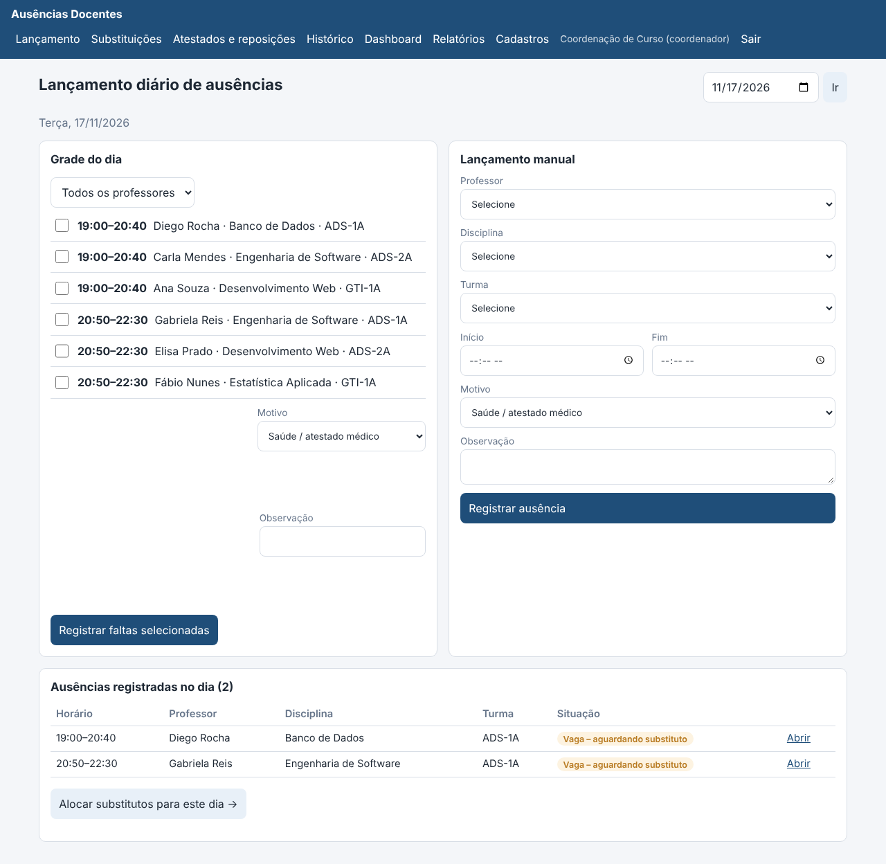
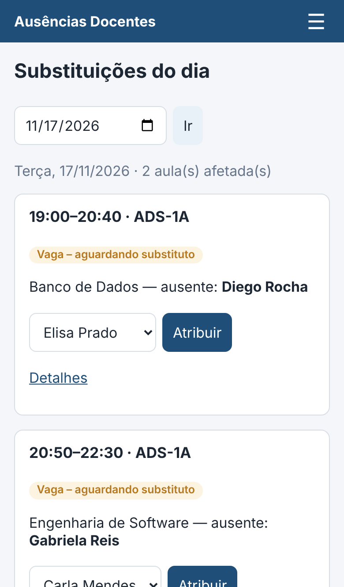
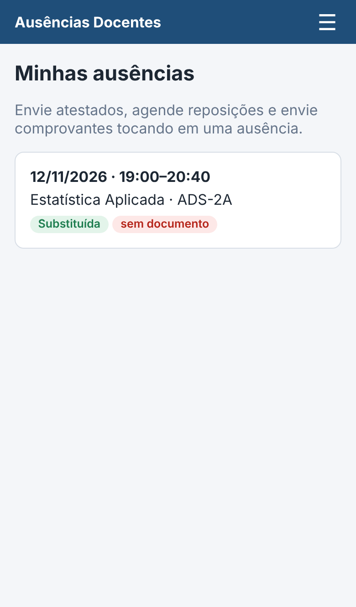

# Manual do usuário

Módulo de Gestão de Ausências Docentes e Substituições.

## Acesso

1. Abra o endereço do sistema no navegador do computador ou do celular.
2. Entre com seu e-mail e senha.
3. Você cai na tela inicial do seu perfil:
   - **Secretaria:** Lançamento diário.
   - **Coordenador:** Dashboard.
   - **Professor:** Minhas ausências.

No celular, o menu fica no botão **☰** no canto superior direito.

---

## Secretaria

### Registrar ausências do dia (pela grade)

1. Menu **Lançamento**. A data de hoje já vem selecionada (troque no campo de data e clique em **Ir** se precisar).
2. Em **Grade do dia**, filtre pelo professor que avisou a falta.
3. Marque as aulas que ele não vai dar.
4. Escolha o **motivo** e, se quiser, escreva uma observação.
5. Clique em **Registrar faltas selecionadas**.

As ausências aparecem na lista **Ausências registradas no dia**.

### Registrar uma ausência manualmente

Use quando a aula não estiver na grade (aula extra, mudança de horário):

1. Em **Lançamento manual**, escolha professor, disciplina, turma, início e fim.
2. Escolha o motivo e clique em **Registrar ausência**.

O sistema não deixa lançar duas faltas do mesmo professor no mesmo horário.

### Alocar substitutos

1. Menu **Substituições** (ou o botão **Alocar substitutos para este dia** no lançamento).
2. Para cada aula, a lista mostra **só os professores livres naquele horário**. Quem dá a mesma disciplina aparece primeiro.
3. Escolha o professor e clique em **Atribuir**.

Se ninguém estiver disponível, abra **Detalhes** e agende uma reposição.

### Entender a situação de cada aula

| Selo | Significado | O que fazer |
|---|---|---|
| 🟢 Substituída | Tem substituto | Nada |
| 🟡 Vaga – aguardando substituto | A aula ainda não acabou | Atribuir substituto |
| 🟣 Vaga – reposição agendada | Sem substituto, reposição marcada | Confirmar a reposição depois |
| 🟢 Reposta | Reposição realizada | Nada |
| 🔴 Vaga – sem cobertura | A aula passou sem substituto nem reposição | Agendar reposição |

### Atestados e reposições

Menu **Atestados e reposições**:

- **Documentos aguardando conferência:** clique no nome do arquivo para abrir, depois em **Aprovar** ou **Recusar**. Atestado aprovado deixa a ausência *justificada*.
- **Reposições agendadas:** marque como **Realizada** ou **Cancelar**.

Também é possível enviar um documento em nome do professor: abra a ausência, escolha o tipo, selecione o arquivo e clique em **Enviar documento**.

### Consultar o histórico

Menu **Histórico**: filtre por período, professor, turma ou situação. Clique em **Abrir** para ver todos os detalhes, inclusive o **histórico de ações** (quem fez o quê e quando).

### Cadastros

Menu **Cadastros**:

- **Importar grade horária:** envie o CSV exportado do sistema acadêmico (modelo em `docs/exemplos/grade.csv`). Professores, disciplinas e turmas novos são criados automaticamente.
- Adicionar professores, disciplinas, turmas e aulas manualmente.
- **Desativar** um professor que saiu (ele deixa de ser sugerido como substituto, mas o histórico é mantido).

---

## Coordenador

O coordenador tem acesso a tudo o que a secretaria acessa, mais:

### Dashboard

1. Menu **Dashboard**. Por padrão mostra os últimos 30 dias.
2. Use os filtros **De / Até / Professor / Turma** e clique em **Filtrar**.
3. Indicadores:
   - **Ausências no período**
   - **Taxa de substituição:** % de aulas com substituto
   - **Aulas cobertas:** substituídas + repostas
   - **Aulas vagas sem cobertura:** precisam de reposição
   - **Reposições agendadas / realizadas**
   - **Ausências com documento**
4. Gráficos de faltas por professor, por turma, por situação e por motivo.

### Relatório em PDF para reuniões

1. No Dashboard, clique em **Exportar PDF** (usa os filtros aplicados), ou vá ao menu **Relatórios**.
2. Para uma reunião com um professor, selecione-o no filtro.
3. O PDF abre em nova aba; salve ou imprima.

O relatório traz os indicadores, o total por professor e o histórico detalhado com substituto, reposições e documentos.

---

## Professor

### Ver minhas ausências

Menu **Minhas ausências**: lista suas faltas com a situação de cada aula e se já há documento enviado.

### Enviar atestado

1. Toque na ausência.
2. Em **Atestados e comprovações**, escolha o tipo (**Atestado médico** ou **Declaração**).
3. Toque em **Escolher arquivo** e selecione o PDF ou tire uma foto.
4. Toque em **Enviar documento**. Ele fica *pendente* até a coordenação conferir.

### Agendar reposição e enviar comprovante

1. Na ausência, abra **Agendar reposição**, preencha data, horário e local e toque em **Agendar**.
2. Depois de dar a aula, envie o comprovante (ex.: foto da lista de presença): tipo **Comprovante de reposição**, escolha a reposição e o arquivo.
3. Quando a coordenação aprovar o comprovante, a reposição é marcada como realizada.

---

## Dúvidas frequentes

**Lancei uma falta errada.** Abra a ausência e clique em **Excluir lançamento** (a exclusão fica registrada).

**O professor que eu quero não aparece como substituto.** Ele tem aula, falta ou outra substituição nesse horário, ou está desativado.

**Qual arquivo posso enviar?** PDF, JPG ou PNG de até 5 MB.

**Esqueci a senha.** Peça à secretaria/TI para recriar seu usuário (`flask --app run criar-usuario`).
